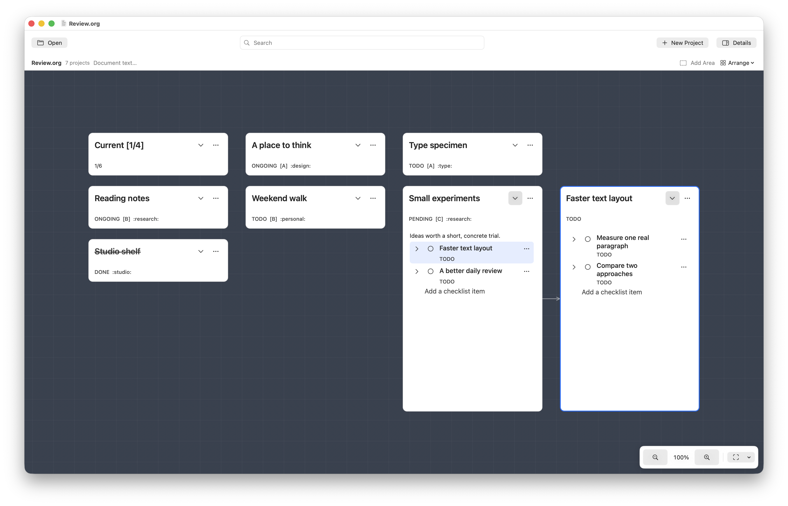

# visual-org

A visual canvas for Emacs Org mode.



## Build and run

Requires macOS 14 or later and Apple's Swift command line tools.

```sh
./build.sh build
./build.sh run Examples/Review.org
```

Open your own file with `./build.sh run /path/to/file.org` or File → Open Org File in the app.
